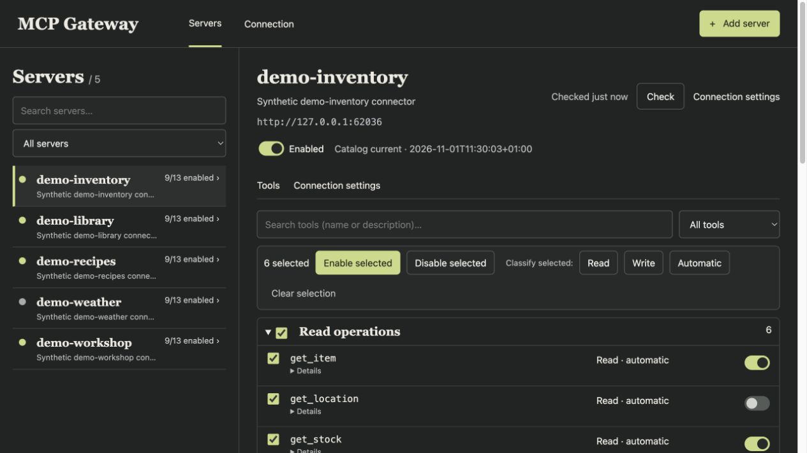
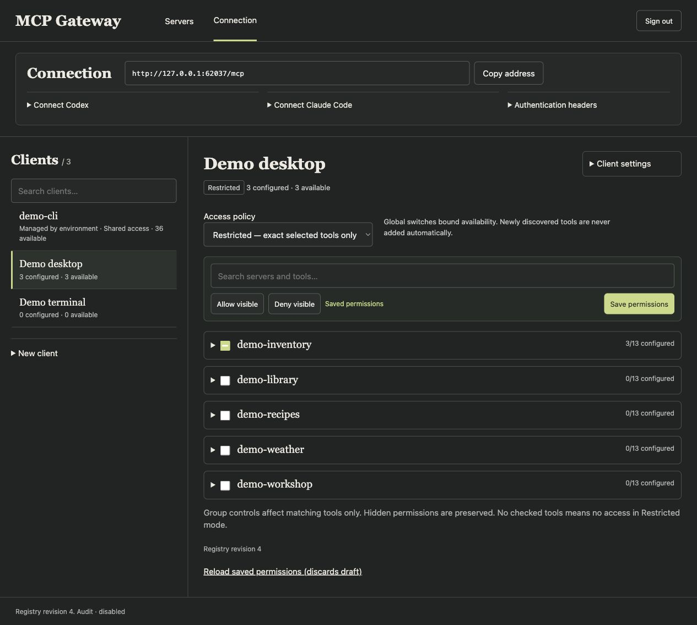
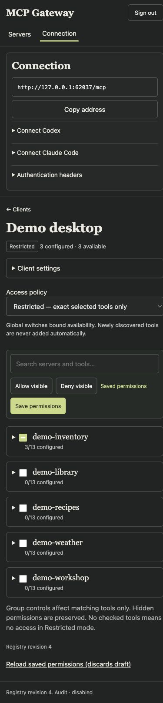

# MCP Gateway

MCP Gateway is a self-hosted Go service that connects Codex, Claude Code and
other Streamable HTTP clients to multiple MCP servers through one endpoint.

## What it is for

Without a gateway, each client needs its own upstream addresses and credentials.
This service keeps those settings in one registry. Applications connect with
separate client keys; adding a server or changing its credentials happens at the
gateway. Each client has an exact list of tools it may use, bounded by global
server and tool switches.

The client receives four gateway tools by default: server discovery, tool
listing, schema lookup and invocation. It can find an upstream tool and load its
schema when needed instead of receiving every upstream definition at startup.
Optional search returns matching tools with their schemas. Optional read batches
run independent permitted reads in one gateway request.

## Administration

The **Servers** workspace manages upstream addresses, authentication, connection
checks and global tool availability. It supports selecting tools in groups to
enable, disable or classify them as Read, Write or Automatic.

The **Connection** workspace manages client keys and permissions. Tools are
grouped by MCP server, so an operator can select a server's current tools or a
subset across several servers and save the selection together. New keys start
without tool access. The page also contains connection instructions for Codex
and Claude Code.

SQLite or PostgreSQL stores the registry and encrypted credentials. Clients use
Bearer or `X-API-Key` authentication; upstream credentials stay at the gateway.

## Screenshots

Captured from a local fixture using synthetic servers, tools and clients.
All endpoints are loopback; keys are hidden.

Servers and tool selection:



Client permissions:



<details>
<summary>Mobile client permissions</summary>



</details>

## Run the web admin

See [self-hosting](docs/self-hosting.md) for SQLite setup, PostgreSQL roles and HTTPS routing. A new installation explicitly migrates and imports an empty bootstrap registry before starting the gateway. Startup never applies migrations automatically.

In the admin, add an upstream, consent to its exact HTTPS endpoint, choose its authentication header, and run the connection check. That check only initializes MCP and lists tools. Enable the server and the tools you want clients to use. New additions default to disabled.

Cloudflare Access protects browser access to the deployed admin. The gateway uses a trusted-proxy compatibility mode behind it; see [self-hosting](docs/self-hosting.md#cloudflare-access). This is separate from the optional MCP Managed OAuth route described below; native MCP clients authenticate with their gateway keys.

The **Connection** page displays the configured MCP URL and lets you create a separate key for each application. Keys are hidden until Show or Copy is pressed. Existing environment-managed keys are preserved and cannot be revealed or deleted there.

## Connect a client

Use the externally routed URL shown on the Connection page. Send exactly one header:

```text
Authorization: Bearer <key>
```

or:

```text
X-API-Key: <same-key>
```

Both, repeated or empty credentials are rejected. Client credentials are never forwarded upstream.

For Codex, set `MCP_GATEWAY_TOKEN` in the environment of the actual Codex process, then add this configuration:

```toml
[mcp_servers.gateway]
url = "https://mcp.example.com/gateway/mcp"
bearer_token_env_var = "MCP_GATEWAY_TOKEN"
```

Replace the example URL with your deployment's URL. Do not put a real key in tracked configuration.

For **Claude Code**, use [the connection guide](docs/claude.md) and
[the MCP configuration example](config/claude-mcp.json.example). It supports
Bearer or `X-API-Key` with an environment variable for the key. The root
`CLAUDE.md` imports the shared `AGENTS.md` contributor instructions.

### Optional Cloudflare Managed OAuth

The gateway can expose a separate `/gateway/mcp/oauth` endpoint for a
Cloudflare Access Managed OAuth application. The native `/gateway/mcp` key
endpoint remains independent and works when OAuth is disabled or Access JWKS
is unavailable. Configure the MCP-specific Access application and the exact
client redirect URI separately; browser-only Access authentication is not
sufficient. The origin requires one signed `Cf-Access-Jwt-Assertion`, verifies
its RS256 signature, issuer, MCP audience, `type=app`, subject, email, `iat`,
and `exp`, then maps the exact email to an existing gateway principal. Current
principal and grants are checked for each operation. Opaque `Bearer oauth:…`
transport values are never treated as native API keys.

The profile is off by default. Enabling it requires the enable flag, the three
remaining `GATEWAY_MCP_ACCESS_*` settings and `GATEWAY_PUBLIC_ORIGIN`.
Partial or malformed configuration stops
startup. See [ChatGPT OAuth deployment guidance](docs/deployment/chatgpt-oauth.md)
for configuration, the prepared Traefik overlay, validation, and rollback.
Local synthetic tests do not establish that a real Cloudflare or ChatGPT
connection works.

## Gateway tools

| Tool | Input | Purpose |
| --- | --- | --- |
| `discover_server` | optional `query`, `limit` | Find enabled, accessible servers |
| `discover_tools` | `server_id` | List accessible tools on a server |
| `get_tool_schema` | `server_id`, `tool_name` | Load the current tool schema |
| `invoke_tool` | `server_id`, `tool_name`, `arguments` | Validate and invoke an upstream tool |

When `GATEWAY_TOOL_SEARCH_ENABLED=true`, the gateway also exposes:

| Tool | Input | Purpose |
| --- | --- | --- |
| `search_tools` | `query`, optional `limit` and `server_id` | Find enabled, accessible tools and return their schemas |

This option is disabled by default. The catalog is held in process memory and
expires 60 seconds after a successful upstream catalog fetch. A successful
admin **Check connection** publishes its checked catalog after the registry
commit, so newly enabled tools can appear in the same client session. Enabling
or disabling a tool applies current access policy and does not refresh the
catalog's expiry time. Upstream change notifications are not used.

Upstream MCP results preserve content types, structured content and `isError`. Schemas and returned content remain untrusted data. Tool annotations do not authorize an invocation.


### Optional read batches

Server initialization instructions describe the shortest supported path: invoke
known tools directly, search unknown tools once, and reuse returned schemas.
With both `GATEWAY_TOOL_SEARCH_ENABLED=true` and
`GATEWAY_READ_BATCH_ENABLED=true`, the gateway exposes `invoke_read_batch`.
`GATEWAY_READ_BATCH_ALLOWLIST` must point to a valid operator-managed JSON file;
see [the synthetic example](config/read-batch.example.json). The exact server,
tool and endpoint tuple must be listed. Upstream annotations do not authorize
batch reads, and the allowlist never grants normal tool access or enables a tool.
Keep this file operator-controlled and replace it atomically.

```json
{"operations": [
  {"id": "alpha", "server_id": "demo", "tool_name": "read_alpha", "arguments": {}},
  {"id": "beta", "server_id": "demo", "tool_name": "read_beta", "arguments": {}}
]}
```

Use batches only for independent reads whose behavior the operator has verified.
Use `invoke_read_batch` for every allowlisted read, including a single read.
Use `invoke_tool` for other operations. Each batch contains 1–8 unique operation IDs;
at most three operations run concurrently per batch, eight globally for batch
workloads, and four batches are admitted concurrently. Busy requests fail fast.
The ten-second request deadline includes queue waiting and upstream calls.
Current client authorization, switches, argument policy, allowlist and connection
inputs are checked again before each invocation. Already dispatched operations
can finish after revocation. No batch invocation is retried or deduplicated. Batch connections also disable
the SDK automatic multi-round-trip continuation middleware.

Results preserve input ID/order and contain per-item `status`, `dispatched` and
an original MCP `tool_result` when available. Inspect every item and `complete`:
a valid envelope with `isError=false` can contain failed operations.
`upstream_error` also covers unsupported input-required results; inspect the
original result rather than assuming its `isError` must be true. A dispatched
transport error or timeout has an unknown upstream outcome. Results over 64 KiB
per item or the 256 KiB total serialized response budget can be replaced with
`result_omitted`; omission is not success and must not trigger an automatic retry.

The feature is off by default and requires no registry change or SQL migration.
In legacy file policy mode the admin UI does not manage batch eligibility. Changing the fixed tool set may
require an initial client refresh; changing the allowlist is read on subsequent
admissions. Generic `invoke_tool` remains capable of writes and is not marked
read-only. Disabling the batch flag restores the five-tool search interface.

## Access and security

A restricted client key can use only exact selected server/tool pairs, bounded by global enable switches and input validation. New keys start with no access; use Connection → Edit permissions. Migrated `legacy_shared` principals retain old shared-tool access until explicitly restricted. Legacy argument constraints still apply to legacy tools. See [Agent ACL and migration](docs/deployment/agent-acl.md).

Client keys authenticate using SHA-256 digests. Recoverable keys are stored separately with AES-256-GCM under `GATEWAY_SECRET_KEY`. Deleting a key revokes subsequent requests, including existing MCP sessions; admitted operations may finish. Protect the admin and keep the encryption key separate from database backups.

Read the [security model](docs/security-model.md) before exposing the service. The gateway does not implement client OAuth, stdio upstreams, legacy SSE upstreams, automatic retries, or semantic approval of modifying operations. HTTPS is terminated by your reverse proxy.

## Development

Set `GATEWAY_TOOL_SEARCH_ENABLED=true` on the gateway process to try the optional
search tool and catalog cache locally. Leave it unset or false to retain the
four-tool catalog.

```sh
go test ./...
go test -race ./...
go vet ./...
go build -o /tmp/mcp-gateway ./cmd/mcp-gateway
go build -o /tmp/mcp-gateway-registry ./cmd/registry
python3 -m unittest discover -s scripts -p 'test_*.py'
node scripts/test_connection_actions.cjs
```

Go tests use synthetic credentials and local listeners. PostgreSQL parity tests require **two separate disposable databases**; they must never run against a production database. See [development](docs/development.md) for the environment variables and CI coverage.

## Layout

- `cmd/mcp-gateway`: HTTP gateway and optional admin process.
- `cmd/registry`: explicit migration, import/export and compatibility commands.
- `cmd/demo`: synthetic MCP server/client.
- `internal/config`, `policy`, `upstream`, `gateway`: registry, authorization and transport.
- `internal/store`, `admin`: persistence, encrypted credentials and web admin.
- `Dockerfile`: non-root image containing gateway and registry binaries.

Publication bundles exclude local deployment history, production settings, screenshots, private credentials and machine-specific agent instructions.


### Connector read profiles (local revision 1)

Set `GATEWAY_READ_BATCH_POLICY_MODE=registry` with tool search and read batch enabled; leave `GATEWAY_READ_BATCH_ALLOWLIST` unset. The legacy default remains `file` and keeps the existing exact operator allowlist. The two sources cannot be combined.

Registry mode exposes one **Batch for reads** switch per connector and a reviewed profile selector. Calendar MCP and Home Assistant profiles permit only exact reviewed read contracts. Unknown or changed tools stay ordinary-only. Ordinary server/tool enablement and client authorization still apply; profile selection does not grant access. No per-tool batch override exists.

The settings persist via existing registry CAS (no SQL migration), while eligibility follows current catalog metadata. Check/TTL and later requests in the same MCP session observe changes. New tool discovery does not automatically enable ordinary access. Search/discovery expose advisory `batch_read_allowed` and `batch_read_reason`; dispatch rechecks them against current policy. Endpoint/auth/credential changes clear the connector batch approval.

See [local acceptance, protocol limitation, future release and rollback](docs/deployment/connector-batch-reading.md). This revision has not been deployed.

Registry documents require `registry_version: 2`. Existing unversioned documents require the explicit offline/SQL migration described in the [ACL runbook](docs/deployment/agent-acl.md). SQL schema remains v2. Local audit is opt-in via `GATEWAY_AUDIT_ENABLED` and `GATEWAY_AUDIT_DIR`.
